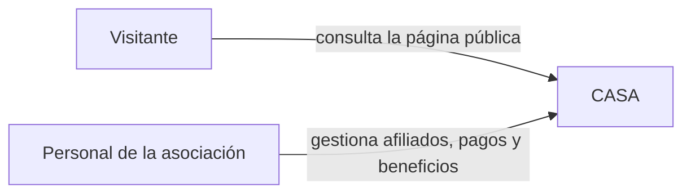
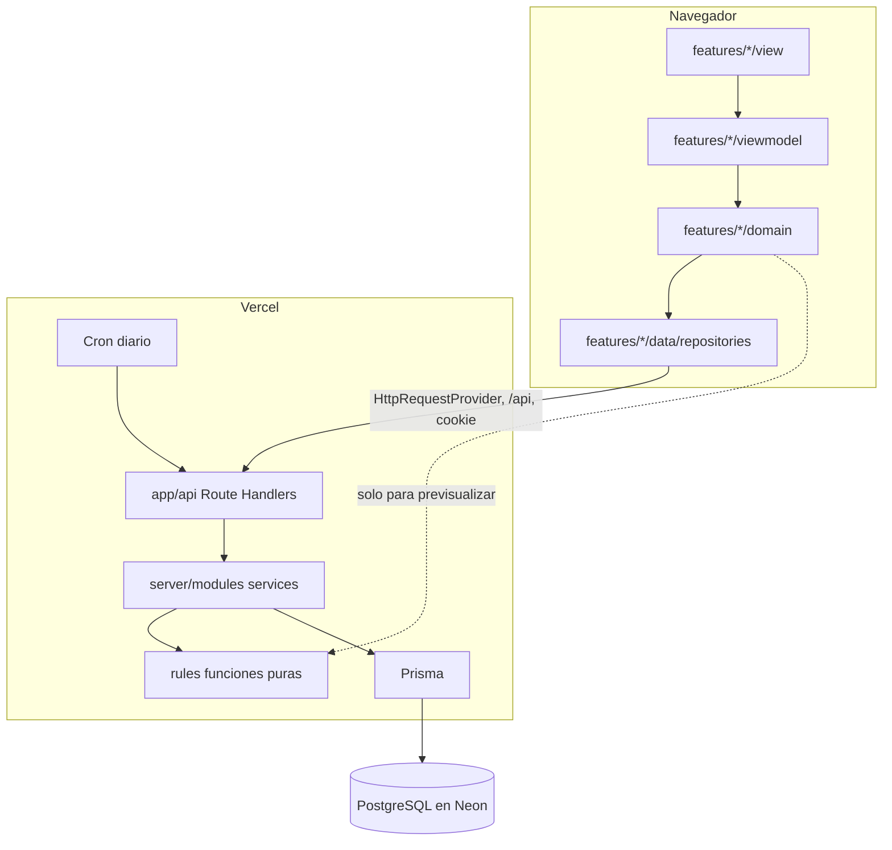
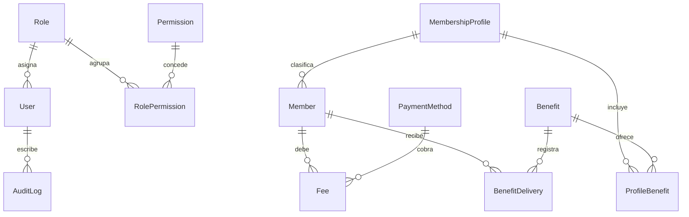

# CASA — Requerimientos y arquitectura

Documento de la primera versión. Es la fuente funcional para construir la aplicación: lo que no esté escrito aquí no se agrega como funcionalidad.

CASA significa **Círculo de Apoyo y Servicios para Afiliados**. Es el nombre inicial y se cambia desde los parámetros, sin tocar código.

Cómo leerlo junto con el resto de `/docs`:

- **Qué hace la aplicación y con qué reglas:** este documento.
- **Por qué la arquitectura es así:** `docs/decisions/ADR-*.md`.
- **Cómo se escribe el código (capas, nombres, UI kit):** `docs/architecture.md`, `docs/conventions.md` y `docs/ui-kit.md`.

Si algo aquí contradice esas reglas, ganan las reglas de `docs/prompts/2_architecture_rules.md`, y se corrige este documento.

## 1. Para qué existe

La asociación entrega beneficios a sus afiliados: regalos, aguinaldo, un paseo al año y, en algunos casos, un auxilio. El descuento por nómina de los pensionados en Colpensiones ha sido difícil de sostener.

Esta aplicación abre la afiliación **por ventanilla**: cualquier persona se afilia, paga su cuota directamente y accede a los servicios. Los servicios se prestan en Medellín.

El personal registra afiliados, marca los pagos y controla quién ya recibió cada beneficio. El afiliado no entra al sistema.

Lleva el control de las cuotas y de los beneficios. No es contabilidad: no hay facturas, impuestos, bancos ni libros contables.

## 2. Alcance de esta versión

Incluye:

- Página pública de presentación.
- Formulario de afiliación en PDF para imprimir y firmar (módulo 10). No sustituye el alta por ventanilla.
- Ingreso solo para el personal, con usuarios, roles y permisos configurables.
- Registro de afiliados por ventanilla.
- Perfiles de afiliación, cada uno con su porcentaje de aporte sobre el salario mínimo.
- Generación mensual de cuotas, mora y recargo.
- Registro del pago en ventanilla: un visto de “pagó”, con medio, fecha y quién lo registró.
- Catálogo de beneficios y control de quién ya lo recibió en el año.
- Listados con búsqueda, filtros y descarga a Excel.

Queda para más adelante:

- Pensionados con descuento por Colpensiones y el cruce por fallecimientos.
- Una zona donde el afiliado consulte su estado.
- Cobros por internet.
- Contabilidad.
- Reportes a la medida. Por ahora basta la descarga a Excel de las tablas.
- Cargar información vieja. No hay Excel ni cuadernos que migrar.
- Alta en línea: el afiliado no se registra solo desde la web.
- Abonos parciales. Cada cuota se paga completa.
- Cuotas de meses que todavía no llegan.
- Recuperar la clave por correo. El administrador asigna una nueva.

## 3. Glosario

Perfil de afiliación y rol de usuario son cosas distintas.

| Término | Qué es | Nombre en código |
|---|---|---|
| Afiliado | Persona inscrita por ventanilla. También se le dice socio | `Member` |
| Perfil de afiliación | Paquete de aporte y beneficios: porcentaje del salario mínimo y beneficios incluidos. No es un usuario del sistema | `MembershipProfile` |
| Usuario | Persona del personal que entra a la aplicación | `User` |
| Rol | Grupo de permisos asignado a un usuario | `Role` |
| Permiso (claim) | Una acción concreta: ver afiliados, registrar un pago, editar parámetros | `Permission` |
| SMMLV | Salario mínimo mensual legal vigente. Parámetro que se actualiza cuando cambia el decreto | `minimumWage` |
| Cuota | Cobro de un mes, o la cuota única de ingreso cuando aplica | `Fee` |
| Recargo | Valor extra por mora: un porcentaje del SMMLV por cada mes de atraso, sumado a la cuota | `surcharge` |
| Medio de pago | Efectivo, transferencia, Nequi, etc. | `PaymentMethod` |
| Beneficio | Regalo, auxilio o actividad que la asociación puede entregar | `Benefit` |
| Entrega | Registro de que un afiliado recibió un beneficio en un año | `BenefitDelivery` |
| Parámetros | La configuración general de la asociación | `Settings` |
| Bitácora | Rastro de quién cambió qué | `AuditLog` |

El texto que ve el usuario va en español. Los identificadores de código, tablas, rutas de API y claves de permiso van en inglés (`docs/conventions.md`).

## 4. Cómo se usa

1. La persona llega y quiere afiliarse. El personal crea la ficha, elige el perfil y guarda.
2. El sistema asigna el número de afiliación y calcula la cuota del mes. Si se afilió después del día de corte, esa primera cuota queda reducida.
3. Si la cuota de ingreso está activa y en esa ficha se decidió cobrarla, queda un cobro único aparte.
4. La persona paga. El personal revisa el valor (cuota más recargo, si hay) y marca **Pagó**, con medio y fecha.
5. Durante el año consulta si esa persona ya puede recibir un beneficio y si ya se le entregó.
6. Cada mes el sistema deja una cuota nueva en **Pendiente** para cada afiliado activo. Pasada la holgura, pasa a **Moroso** y se le suma el recargo.

## 5. Arquitectura

Resumen de las decisiones. El detalle y el porqué están en los ADR.

| Tema | Decisión | ADR |
|---|---|---|
| Despliegue | Una sola aplicación Next.js (App Router) en Vercel, plan Hobby. Sin exportación estática | ADR-001 |
| Sesión | Correo y clave propios. Cookie HttpOnly con JWT firmado. Permisos leídos de la base en cada petición | ADR-002 |
| Backend | Route Handlers en `src/app/api`, servicios en `src/server`, reglas puras en `src/rules` | ADR-003 |
| Datos | PostgreSQL en Neon con Prisma, migraciones versionadas y respaldo semanal | ADR-004 |
| Proceso | Un documento por módulo, sin historias de usuario | ADR-005 |
| Interfaz | Kit de la plantilla: MUI con botones píldora, tablas PrimeReact, verde bosque `#1E5631` | `docs/ui-kit.md` |

### 5.1 Contexto



No hay integración con Colpensiones, bancos ni pasarelas.

### 5.2 Piezas



Reglas de dependencia:

- El frontend sigue el MVVM de la plantilla. La única capa que habla con el servidor es `data/repositories`, a través de `HttpRequestProvider` contra `/api`.
- Los Route Handlers son delgados: sesión, permiso, validación de la entrada con Zod y llamada al servicio.
- Los servicios de `src/server/modules` aplican las reglas, abren transacciones y escriben la bitácora.
- Las fórmulas de cuota, recargo y beneficios existen una sola vez, en `src/rules`. El frontend puede usarlas para mostrar un desglose antes de confirmar. El valor que se guarda lo calcula siempre el servidor.
- Todo archivo de `src/server` importa `server-only`.

### 5.3 Carpetas

```text
prisma/
  schema.prisma
  migrations/
  seed.ts
src/
  middleware.ts                  redirige a /login sin sesión en rutas del panel
  app/
    page.tsx                     página pública (sin shell)
    (panel)/                     shell: header, menú lateral, migas
      layout.tsx
      login/page.tsx             caso especial, sin shell
      cambiar-clave/page.tsx
      home/page.tsx
      afiliados/page.tsx
      pagos/page.tsx
      beneficios/page.tsx
      beneficios/entregas/page.tsx
      perfiles/page.tsx
      usuarios/page.tsx
      roles/page.tsx
      parametros/page.tsx
    api/                         ver 5.5
  features/                      MVVM: data, domain, viewmodel, view
    login/ site/ home/ members/ fees/ benefits/ profiles/ users/ roles/ settings/
  rules/
    money.ts calendar.ts fees.ts benefits.ts   (+ *.test.ts)
  server/
    db/prisma.ts
    auth/session.ts password.ts permissions.ts
    http/errors.ts
    modules/<modulo>/<modulo>.schema.ts .repository.ts .service.ts
  core/ shared/ styles/ config/ environments/   (de la plantilla)
```

Las páginas `ejemplo` y `form` de la plantilla quedan como referencia del kit. Se retiran del menú cuando exista el primer módulo real.

### 5.4 Rutas de pantalla

| Ruta | Quién | Permiso para verla |
|---|---|---|
| `/` | Público | Ninguno |
| `/login` | Público | Ninguno |
| `/cambiar-clave` | Personal | Sesión |
| `/home` | Personal | Sesión |
| `/afiliados` | Personal | `members.view` |
| `/pagos` | Personal | `fees.view` |
| `/beneficios` | Personal | `benefits.view` |
| `/beneficios/entregas` | Personal | `benefits.view` |
| `/perfiles` | Personal | `profiles.view` |
| `/usuarios` | Personal | `users.view` |
| `/roles` | Personal | `roles.view` |
| `/parametros` | Personal | `settings.view` |

Protección:

- **`middleware.ts`:** si no hay cookie válida, redirige a `/login` desde cualquier ruta del panel.
- **Menú (`menuItems.ts`):** cada ítem declara su `permission` y se oculta si el usuario no la tiene.
- **`AuthGuard` y el layout del panel:** muestran "Acceso no permitido por tu rol" si se escribe la ruta a mano.
- **API:** la seguridad real la pone la API, que vuelve a validar el permiso en cada petición.

### 5.5 API

Todas responden JSON. Los errores tienen la forma `{ message, errors? }`. Códigos usados:

- **400:** validación o credenciales incorrectas.
- **401:** sin sesión o sesión vencida.
- **403:** sin permiso.
- **404:** no existe.
- **409:** conflicto de regla, por ejemplo una cuota ya pagada o un cupo del beneficio ya usado.

| Método y ruta | Permiso | Qué hace |
|---|---|---|
| `POST /api/auth/login` | Ninguno | Valida correo y clave, crea la cookie y devuelve el usuario |
| `GET /api/auth/me` | Sesión | Usuario actual con rol, permisos y `mustChangePassword` |
| `POST /api/auth/logout` | Sesión | Borra la cookie |
| `POST /api/auth/password` | Sesión | Cambia la clave propia |
| `GET /api/public/site` | Ninguno | Nombre, contacto y beneficios visibles para la página pública |
| `GET /api/dashboard` | Sesión | Conteos del inicio y recordatorios del mes |
| `GET /api/members` | `members.view` | Listado con filtros y totales calculados |
| `POST /api/members` | `members.create` | Alta, con su cuota del mes y la de ingreso si aplica |
| `GET /api/members/[id]` | `members.view` | Ficha completa |
| `PATCH /api/members/[id]` | `members.edit` | Editar datos, estado o perfil |
| `GET /api/members/[id]/benefits?year=` | `benefits.view` | Elegibilidad de cada beneficio de su perfil en ese año |
| `GET /api/fees` | `fees.view` | Cuotas filtradas por año, mes, estado, afiliado y medio |
| `POST /api/fees/pay` | `fees.pay` | Marca como pagadas una o varias cuotas del mismo afiliado |
| `POST /api/fees/[id]/revert` | `fees.revert` | Deshace un pago, con nota obligatoria |
| `GET /api/benefits` | `benefits.view` | Catálogo |
| `POST /api/benefits` · `PATCH /api/benefits/[id]` | `benefits.manage` | Crear y editar |
| `GET /api/benefit-deliveries` | `benefits.view` | Entregas filtradas por año, beneficio y afiliado |
| `POST /api/benefit-deliveries` | `benefits.deliver` o `benefits.deliver_exception` | Registrar entrega |
| `POST /api/benefit-deliveries/[id]/void` | `benefits.void_delivery` | Anular con nota |
| `GET /api/profiles` | `profiles.view` | Perfiles con la cuota resultante |
| `POST /api/profiles` · `PATCH /api/profiles/[id]` | `profiles.manage` | Crear y editar |
| `GET /api/settings` | `settings.view` | Parámetros |
| `PATCH /api/settings` | `settings.edit` | Cambiar parámetros |
| `GET /api/payment-methods` | Sesión | Medios activos (para cobrar) |
| `POST /api/payment-methods` · `PATCH /api/payment-methods/[id]` | `settings.edit` | Crear y editar medios |
| `GET /api/users` | `users.view` | Usuarios |
| `POST /api/users` · `PATCH /api/users/[id]` | `users.manage` | Crear, editar, activar, desactivar, asignar rol o clave |
| `GET /api/roles` · `GET /api/permissions` | `roles.view` | Roles y catálogo de permisos |
| `POST /api/roles` · `PATCH /api/roles/[id]` | `roles.manage` | Crear roles y asignar permisos |
| `GET /api/cron/fees` | `CRON_SECRET` | Proceso diario de cuotas |

### 5.6 Proceso diario y generación al consultar

Las dos vías ejecutan el mismo servicio, `ensureFeesUpToDate(today)`:

1. Para cada afiliado **Activo**, crear la cuota mensual del mes en curso si no existe. La unicidad de la base evita duplicados aunque dos peticiones lleguen a la vez.
2. Pasar a Moroso las cuotas mensuales Pendientes cuya fecha límite ya pasó.

El cron de Vercel llama `GET /api/cron/fees` a las 00:10 hora de Colombia (`10 5 * * *` en UTC) con `Authorization: Bearer CRON_SECRET`. En el plan Hobby la hora no es exacta.

Además, `GET /api/dashboard`, `GET /api/fees` y `GET /api/members/[id]` ejecutan el mismo servicio antes de responder. Así el día 1 hay cuota aunque el cron no haya corrido.

Al crear un afiliado activo, su cuota del mes en curso se crea en la misma transacción.

### 5.7 Fechas, dinero y zona horaria

- **Zona horaria de negocio:** `America/Bogota`. "Hoy" y el mes en curso se calculan en `src/rules/calendar.ts` con esa zona, nunca con la del servidor (Vercel corre en UTC).
- **Fechas de calendario:** afiliación, nacimiento, vencimiento y pago se guardan como `@db.Date`, sin hora. La bitácora guarda fecha y hora en UTC.
- **Pesos:** enteros (`Int`).
- **Porcentajes:** `Decimal(6,2)`. Los cálculos de dinero usan `Prisma.Decimal` o enteros escalados, nunca `number` con decimales.

### 5.8 Seguridad

- La página pública no lista afiliados, documentos, teléfonos ni pagos.
- Los datos personales se tratan según la Ley Estatutaria 1581 de 2012 y el Decreto 1377 de 2013, solo para gestionar la afiliación, las cuotas y los beneficios. La autorización se firma en el formulario de afiliación (§10.11).
- La asociación no reporta a centrales de riesgo ni a operadores de información financiera, no consulta historiales crediticios y no comparte datos de afiliados con terceros. La aplicación no tiene integraciones ni exportaciones para eso.
- Las claves se guardan con hash `bcryptjs`.
- Cada escritura exige sesión y permiso, y queda en la bitácora.
- No se borran afiliados, usuarios, cuotas ni entregas. Se desactivan, se retiran o se anulan.
- La ruta del cron rechaza llamadas sin el secreto.
- Ningún secreto lleva el prefijo `NEXT_PUBLIC_`.

## 6. Permisos y roles

| Módulo | Clave | Nombre en pantalla |
|---|---|---|
| Afiliados | `members.view` | Ver afiliados |
| Afiliados | `members.create` | Crear afiliados |
| Afiliados | `members.edit` | Editar afiliados, su estado y su perfil |
| Pagos | `fees.view` | Ver cuotas y pagos |
| Pagos | `fees.pay` | Registrar pagos |
| Pagos | `fees.revert` | Corregir pagos |
| Beneficios | `benefits.view` | Ver beneficios y entregas |
| Beneficios | `benefits.manage` | Administrar el catálogo de beneficios |
| Beneficios | `benefits.deliver` | Entregar beneficios |
| Beneficios | `benefits.deliver_exception` | Entregar con excepción |
| Beneficios | `benefits.void_delivery` | Anular entregas |
| Perfiles | `profiles.view` | Ver perfiles |
| Perfiles | `profiles.manage` | Administrar perfiles |
| Parámetros | `settings.view` | Ver parámetros |
| Parámetros | `settings.edit` | Editar parámetros y medios de pago |
| Usuarios | `users.view` | Ver usuarios |
| Usuarios | `users.manage` | Administrar usuarios |
| Roles | `roles.view` | Ver roles |
| Roles | `roles.manage` | Administrar roles y permisos |

Los permisos son un catálogo fijo que crea la semilla. Agregar uno nuevo es un cambio de código, porque cada clave se comprueba en una ruta de la API.

**Administrador.** Todos los permisos. Es rol de sistema: no se elimina ni se desactiva.

**Operativo.** Trabajo de ventanilla:

- Afiliados: `members.view`, `members.create`, `members.edit`.
- Pagos: `fees.view`, `fees.pay`, `fees.revert`.
- Beneficios: `benefits.view`, `benefits.deliver`.
- Perfiles: `profiles.view`.

El operativo no cambia parámetros, no administra usuarios ni roles, no modifica el catálogo, no entrega con excepción y no anula entregas.

Reglas de usuarios:

- Un usuario inactivo no entra y no se borra.
- El correo es único y obligatorio. La clave tiene mínimo 8 caracteres.
- El primer administrador lo crea la semilla con `ADMIN_EMAIL` y `ADMIN_PASSWORD`, con `mustChangePassword = true`.
- Cuando el administrador asigna una clave a otro usuario, también queda `mustChangePassword = true`.
- Nadie puede quitarse a sí mismo el rol Administrador ni desactivarse. Así siempre queda al menos un administrador activo.

## 7. Parámetros

Una sola fila de `Settings`. Valores iniciales:

| Campo | Inicial | Efecto |
|---|---|---|
| Nombre | Círculo de Apoyo y Servicios para Afiliados | Página pública |
| Sigla | CASA | Página pública |
| Ciudad de servicios | Medellín | Página pública |
| Teléfono, correo, dirección, horario | Vacíos | Página pública |
| SMMLV | 0 | En 0 no se genera ninguna cuota ni se puede afiliar. Hay que escribir el salario vigente antes |
| Día de corte de la primera cuota | 15 | Si el día de afiliación es mayor, la primera cuota se reduce |
| Porcentaje de esa primera cuota | 50 | Solo la primera cuota mensual |
| Días de holgura | 3 | Después del último día del mes, la cuota sigue Pendiente estos días |
| Porcentaje de recargo mensual | 0 | Porcentaje del SMMLV por cada mes de atraso. En 0 hay mora, pero el total no sube |
| Cuota única de ingreso | 0 | En 0 no se ofrece |
| Pagar varias cuotas a la vez | Sí | Varias cuotas ya generadas del mismo afiliado |

Medios de pago iniciales, editables: Efectivo, Transferencia, Nequi, Daviplata, Otro.

Al cambiar el SMMLV, el valor nuevo entra en las cuotas que se generen después. Las ya generadas conservan el SMMLV, el porcentaje y el valor base con los que nacieron. El cambio queda en la bitácora con el valor anterior, el nuevo y quién lo hizo.

El nombre visible del shell (encabezado, login, pestaña del navegador) sale de `NEXT_PUBLIC_APP_*` en `appConfig`. El nombre y el contacto de la página pública salen de `Settings`. Al inicio coinciden.

### 7.1 Redondeo

`roundPesos(x)` redondea al peso más cercano. Los 50 centavos redondean hacia arriba.

Ejemplo, con cifras de muestra: SMMLV $1.000.000 al 1,7% da $17.000.

## 8. Reglas de negocio

Estas funciones viven en `src/rules` y son la única implementación de las fórmulas. Cada una tiene pruebas en Vitest con los ejemplos de esta sección.

### 8.1 Cuota mensual (`rules/fees.ts`)

```text
fullFee = roundPesos(minimumWage × profilePercent / 100)

si es la primera cuota mensual del afiliado
   y el día de joinedOn > firstFeeCutoffDay:
  baseAmount = roundPesos(fullFee × firstFeePercent / 100)
  isReduced = true
si no:
  baseAmount = fullFee
  isReduced = false
```

Con los valores iniciales, afiliarse el día 16 o después deja esa primera cuota al 50%. El mes siguiente se cobra completo.

La cuota reducida, ya pagada, cuenta como una cuota del año. Cuenta el mes, no el valor.

Solo se genera el mes en curso y solo para afiliados **Activos**:

- No se crean meses futuros.
- No se crean meses anteriores a la fecha de afiliación.
- No se crean meses en los que estuvo suspendido o retirado. Al volver a Activo, la generación sigue desde el mes actual.

Cambiar el perfil no altera cuotas ya generadas. Las nuevas usan el perfil vigente en el momento de generarse.

Cada cuota mensual guarda, congelados al crearla:

- periodo (año y mes)
- SMMLV usado
- porcentaje del perfil
- valor base
- si fue reducida y con qué porcentaje
- fecha de vencimiento: último día de ese mes
- fecha límite: vencimiento más los días de holgura vigentes en ese momento

Si después cambian la holgura o el día de corte, las cuotas ya creadas no se reescriben.

### 8.2 Estados y recargo (`rules/fees.ts`)

| Estado | Código | Cuándo |
|---|---|---|
| Pendiente | `PENDING` | Sin pagar, y hoy es anterior o igual a la fecha límite |
| Moroso | `OVERDUE` | Sin pagar, y hoy es posterior a la fecha límite |
| Pagado | `PAID` | El personal marcó el pago. El valor queda fijo |

```text
si la cuota está PAID:
  monthsLate = los guardados al pagar
  surcharge = el guardado al pagar
si hoy <= dueLimit:
  monthsLate = 0
  surcharge = 0
si no:
  monthsLate = máximo(1, meses calendario entre el periodo y el mes actual)
  unitSurcharge = roundPesos(minimumWageUsed × surchargePercentVigente / 100)
  surcharge = monthsLate × unitSurcharge

total = baseAmount + surcharge
```

El porcentaje de recargo se lee de los parámetros mientras la cuota no esté pagada. Por eso, subirlo desde 0 empieza a afectar también a las cuotas que ya estaban morosas. El SMMLV del recargo es el que quedó guardado en esa cuota, no el salario nuevo.

El recargo aparece completo el día en que pasa a Moroso. No se prorratea por días. No es un porcentaje de la cuota ni un interés compuesto.

Ejemplo, cuota de octubre, holgura de 3 días:

| Fecha | Estado | Meses de atraso |
|---|---|---|
| Hasta el 3 de noviembre | Pendiente | 0 |
| 4 de noviembre | Moroso | 1 |
| 1 de diciembre, si sigue sin pagar | Moroso | 2 |

Ejemplo de valor, con cifras de muestra: SMMLV $1.000.000, cuota $17.000, recargo configurado en 0,5% ($5.000 por mes). Pagada en diciembre con 2 meses de atraso: $17.000 + $10.000 = $27.000.

Al marcar el pago se congelan meses de atraso, porcentaje de recargo usado, valor del recargo y total. Después de pagada, el recargo no sigue creciendo aunque pasen los meses o cambie el parámetro.

La mora del afiliado es derivada: está en mora si tiene al menos una cuota mensual en Moroso. La cuota de ingreso no produce mora ni recargo.

### 8.3 Marcar el pago

No hay cobro en línea. El personal confirma que el dinero ya se recibió.

Datos del pago:

- Medio de pago, obligatorio.
- Fecha de pago, obligatoria. Por defecto, hoy en Colombia. Se puede corregir si se registra al día siguiente. No puede ser futura.
- Observación, opcional.

El sistema guarda quién lo marcó y en qué momento.

Antes de confirmar se muestra el desglose: base, recargo y total. Si son varias, cada una y la suma. El desglose de pantalla usa `src/rules`. El servidor lo vuelve a calcular al guardar.

Si el parámetro de varias cuotas está activo, se marcan juntas varias cuotas ya generadas del mismo afiliado, en Pendiente o Moroso. Comparten medio y fecha. Cada una conserva su base y su recargo. No se fusionan en un solo registro.

Si el parámetro está apagado, la API rechaza más de una cuota por petición.

No se aceptan abonos. No se anticipan meses sin generar.

Corregir un pago exige `fees.revert` y una nota obligatoria:

- La cuota vuelve a Pendiente o Moroso según la fecha, y el recargo vuelve a calcularse.
- El rastro queda en la bitácora: quién marcó, quién corrigió, cuándo, la nota y los valores que tenía.

### 8.4 Cuota de ingreso

Si el parámetro es mayor que 0, el formulario de alta pregunta si se cobra. Si la respuesta es sí, en la misma transacción se crea una cuota de tipo `ENROLLMENT`, en Pendiente, por ese valor fijo.

No tiene porcentaje, reducción, recargo ni mora. Se marca pagada y se corrige como las demás. Cada afiliado tiene como máximo una. No cuenta para el mínimo de cuotas de los beneficios.

Si el parámetro está en 0, el formulario no la ofrece.

### 8.5 Estados del afiliado

| Estado | Código | Cuotas nuevas | Deuda ya generada | Beneficios |
|---|---|---|---|---|
| Activo | `ACTIVE` | Sí, el mes en curso | Se puede pagar | Se entregan si cumple las reglas |
| Suspendido | `SUSPENDED` | No | Sigue y se puede pagar | No se entregan |
| Retirado | `RETIRED` | No | Sigue visible y se puede pagar | No se entregan |

El historial se conserva en los tres estados.

### 8.6 Beneficios (`rules/benefits.ts`)

Para entregar sin excepción se cumplen todas:

1. El afiliado está Activo.
2. Su perfil incluye ese beneficio.
3. El sexo coincide. "No indica" no coincide con "solo mujeres" ni con "solo hombres".
4. Las cuotas mensuales pagadas cuyo periodo cae en ese año calendario son al menos el mínimo del beneficio. El año es el del periodo, no el de la fecha en que se digitó el pago.
5. En ese año no supera las veces permitidas. Un beneficio anual permite una. Uno eventual permite su máximo.
6. Si el beneficio exige configurar el mínimo y ese mínimo sigue en 0, no se entrega con el permiso normal.

La cuota de ingreso no suma. La primera cuota reducida sí suma un mes.

`evaluateBenefit(...)` devuelve la lista de condiciones con su resultado, para que la pantalla muestre cuáles cumple y cuáles no.

Quien tenga `benefits.deliver_exception` puede entregar aunque fallen las condiciones 1 a 4 o la 6. La nota es obligatoria.

La condición 5 no admite excepción: entregar de más en el mismo año no se permite. Si una entrega fue un error, se anula con `benefits.void_delivery` y una nota. La anulada no cuenta para el cupo y queda en la bitácora.

Cada entrega guarda afiliado, beneficio, año, fecha, quién la hizo, si fue excepción y la observación.

### 8.7 Datos que se calculan al consultar

No se guardan en el afiliado, para no desactualizarse:

| Dato | Cálculo |
|---|---|
| Cuota vigente | Cuota plena del perfil actual con el SMMLV actual. Es informativa. La deuda real está en las cuotas generadas |
| En mora | Existe una cuota mensual en Moroso |
| Total aportado | Suma de `totalPaid` de todas sus cuotas pagadas, ingreso incluido |
| Cuotas pagadas del año | Cuotas mensuales pagadas con periodo en ese año |

## 9. Modelo de datos

Nombres de modelos y campos tal como irán en `prisma/schema.prisma`. Las tablas se mapean a `snake_case` con `@@map`. Por ejemplo, el modelo `Member` queda en la tabla `members` y el campo `joinedOn` en la columna `joined_on`.

### 9.1 Relaciones



- Un usuario tiene un rol. Un rol tiene muchos usuarios.
- Un rol tiene muchos permisos y un permiso está en muchos roles.
- Un afiliado tiene un perfil. Un perfil tiene muchos afiliados.
- Un perfil incluye muchos beneficios y un beneficio está en muchos perfiles.
- Un afiliado tiene muchas cuotas y muchas entregas.
- Un medio de pago está en muchas cuotas pagadas.
- La configuración es una sola fila.
- La bitácora guarda el usuario y el id de la entidad afectada, sin clave ajena por tabla.

Identificadores internos: `String @id @default(uuid()) @db.Uuid`. El número de afiliación es otro campo, consecutivo y visible.

Borrado físico: no se usa en datos de negocio. Las claves ajenas hacia catálogos usan `onDelete: Restrict`. Perfiles, beneficios, medios y roles se desactivan.

### 9.2 Enumeraciones

| Enum | Valores |
|---|---|
| `DocumentType` | `CC`, `CE`, `PASSPORT`, `PPT` |
| `Sex` | `FEMALE`, `MALE`, `UNSPECIFIED` |
| `MemberStatus` | `ACTIVE`, `SUSPENDED`, `RETIRED` |
| `FeeType` | `MONTHLY`, `ENROLLMENT` |
| `FeeStatus` | `PENDING`, `OVERDUE`, `PAID` |
| `BenefitType` | `ANNUAL`, `EVENTUAL` |
| `BenefitAudience` | `ALL`, `FEMALE`, `MALE` |

### 9.3 `Settings`

Una fila, con `id = 1`.

| Campo | Tipo | Regla |
|---|---|---|
| id | Int | Siempre 1 |
| name | String | Obligatorio |
| acronym | String | Obligatorio |
| serviceCity | String | Obligatorio |
| phone | String? | |
| contactEmail | String? | |
| address | String? | |
| openingHours | String? | |
| minimumWage | Int | ≥ 0. 0 bloquea afiliar y generar cuotas |
| firstFeeCutoffDay | Int | 1 a 28 |
| firstFeePercent | Decimal(6,2) | 1 a 100. 50 significa 50% |
| graceDays | Int | 0 a 15 |
| surchargePercent | Decimal(6,2) | ≥ 0. 0,50 significa 0,50% del SMMLV |
| enrollmentFee | Int | ≥ 0, en pesos |
| allowMultiFeePayment | Boolean | |
| updatedAt | DateTime | |

### 9.4 `PaymentMethod`

| Campo | Tipo | Regla |
|---|---|---|
| id | Uuid | |
| name | String | Único |
| isActive | Boolean | El inactivo no sale al cobrar; las cuotas viejas lo conservan |
| sortOrder | Int | Orden en la lista |

### 9.5 `User`

| Campo | Tipo | Regla |
|---|---|---|
| id | Uuid | |
| name | String | Obligatorio |
| email | String | Único, en minúsculas |
| passwordHash | String | Nunca sale de la API |
| roleId | Uuid | Obligatorio |
| isActive | Boolean | |
| mustChangePassword | Boolean | Verdadero al crearlo o al asignarle clave |
| lastLoginAt | DateTime? | |
| createdAt · updatedAt | DateTime | |

### 9.6 `Role`

| Campo | Tipo | Regla |
|---|---|---|
| id | Uuid | |
| name | String | Único |
| description | String? | |
| isSystem | Boolean | Administrador y Operativo. No se eliminan ni se desactivan |
| isActive | Boolean | Un rol inactivo no se asigna a usuarios nuevos |

### 9.7 `Permission` y `RolePermission`

`Permission`: catálogo fijo creado por la semilla, que no se edita desde la pantalla.

| Campo | Tipo | Regla |
|---|---|---|
| id | Uuid | |
| key | String | Única. Ejemplo: `fees.pay` |
| module | String | `members`, `fees`, `benefits`, `profiles`, `settings`, `users`, `roles` |
| label | String | Texto en español para armar roles |

`RolePermission`: `roleId` y `permissionId`, con clave primaria compuesta.

### 9.8 `MembershipProfile`

| Campo | Tipo | Regla |
|---|---|---|
| id | Uuid | |
| name | String | Único |
| percent | Decimal(6,2) | > 0 y ≤ 100. 1,70 significa 1,70% del SMMLV |
| isActive | Boolean | El inactivo no se asigna a afiliados nuevos. Quien ya lo tiene lo conserva |
| createdAt · updatedAt | DateTime | |

### 9.9 `Benefit` y `ProfileBenefit`

| Campo | Tipo | Regla |
|---|---|---|
| id | Uuid | |
| name | String | Obligatorio |
| internalDescription | String | Obligatorio |
| publicText | String? | Obligatorio si `isPublic` |
| isPublic | Boolean | |
| type | BenefitType | |
| audience | BenefitAudience | |
| minPaidFeesInYear | Int | ≥ 0 |
| maxDeliveriesPerYear | Int | Anual: siempre 1. Eventual: 1 a 12 |
| suggestedMonth | Int? | 1 a 12. Solo para el recordatorio del inicio |
| requiresMinimumSetup | Boolean | Si es verdadero y el mínimo está en 0, la entrega normal se bloquea |
| isActive | Boolean | El inactivo desaparece de la página pública |
| createdAt · updatedAt | DateTime | |

`ProfileBenefit`: `profileId` y `benefitId`, con clave primaria compuesta.

### 9.10 `Member`

| Campo | Tipo | Regla |
|---|---|---|
| id | Uuid | |
| documentType | DocumentType | Obligatorio |
| documentNumber | String | Único junto con el tipo |
| firstNames | String | Obligatorio |
| lastNames | String | Obligatorio |
| sex | Sex | Obligatorio |
| birthDate | Date | No futura. Sin edad mínima |
| mobilePhone | String | Obligatorio |
| phone | String? | |
| email | String? | No tiene que ser único |
| address | String | Obligatorio |
| residenceCity | String | Obligatorio. Puede ser distinta de Medellín |
| shirtSize | String? | Sugeridos: XS, S, M, L, XL, XXL u otro texto |
| pantsSize | String? | |
| shoeSize | String? | |
| memberNumber | Int | Único. `@default(autoincrement())` en una secuencia propia. No se edita ni se reutiliza. Se muestra con 4 dígitos |
| joinedOn | Date | Por defecto, hoy |
| profileId | Uuid | Perfil activo al asignarlo |
| status | MemberStatus | |
| notes | String? | |
| createdById | Uuid | Usuario que lo registró |
| createdAt · updatedAt | DateTime | |

Unicidad: `(documentType, documentNumber)` y `memberNumber`.

Índices: `status`, `profileId`, `lastNames`.

### 9.11 `Fee`

| Campo | Tipo | Regla |
|---|---|---|
| id | Uuid | |
| memberId | Uuid | |
| type | FeeType | |
| periodYear | Int? | Obligatorio si es mensual |
| periodMonth | Int? | 1 a 12 si es mensual |
| minimumWageUsed | Int | Congelado. En ingreso, 0 |
| profilePercent | Decimal(6,2) | Congelado. En ingreso, 0 |
| baseAmount | Int | En ingreso, el valor del parámetro en ese momento |
| isReduced | Boolean | Solo en mensual |
| reductionPercent | Decimal(6,2)? | |
| dueDate | Date | Último día del periodo. En ingreso, la fecha de afiliación |
| dueLimit | Date | Vencimiento más holgura, congelada. En ingreso no dispara mora |
| status | FeeStatus | El ingreso solo usa `PENDING` y `PAID` |
| paidOn | Date? | Obligatoria al pagar |
| paymentMethodId | Uuid? | Obligatorio al pagar |
| paymentNote | String? | |
| paidById | Uuid? | |
| paidAt | DateTime? | Momento del registro, no la fecha de pago |
| monthsLateCharged | Int? | Congelado al pagar |
| surchargePercentApplied | Decimal(6,2)? | Congelado al pagar |
| surchargeAmount | Int? | Congelado al pagar. 0 si pagó a tiempo |
| totalPaid | Int? | `baseAmount + surchargeAmount`, congelado al pagar |
| createdAt | DateTime | |

Unicidad de la mensual: `(memberId, periodYear, periodMonth)`.

Unicidad del ingreso: un solo `ENROLLMENT` por afiliado, con índice único parcial (`WHERE type = 'ENROLLMENT'`) creado en una migración SQL.

Índices: `status`, `(periodYear, periodMonth)`, `(memberId, status)`.

Al corregir un pago se limpian `paidOn`, `paymentMethodId`, `paymentNote`, `paidById`, `paidAt`, `monthsLateCharged`, `surchargePercentApplied`, `surchargeAmount` y `totalPaid`, y el estado vuelve a calcularse.

### 9.12 `BenefitDelivery`

| Campo | Tipo | Regla |
|---|---|---|
| id | Uuid | |
| memberId | Uuid | |
| benefitId | Uuid | |
| year | Int | Año calendario de la entrega |
| deliveredOn | Date | |
| deliveredById | Uuid | |
| isException | Boolean | |
| note | String? | Obligatoria si es excepción |
| isVoided | Boolean | Por defecto falso |
| voidedById | Uuid? | |
| voidedAt | DateTime? | |
| voidNote | String? | Obligatoria al anular |
| createdAt | DateTime | |

No hay unicidad en la base, porque una entrega anulada debe poder repetirse. El servicio cuenta las no anuladas del mismo afiliado, beneficio y año dentro de la transacción, y rechaza con 409 si ya alcanzó el máximo.

Índice: `(memberId, benefitId, year, isVoided)`.

### 9.13 `AuditLog`

| Campo | Tipo | Regla |
|---|---|---|
| id | Uuid | |
| at | DateTime | UTC |
| userId | Uuid? | Vacío solo cuando escribe el cron |
| entity | String | `member`, `fee`, `benefit_delivery`, `settings`, `user`, `role`, `profile`, `benefit`, `payment_method` |
| entityId | String | |
| action | String | Ver lista |
| detail | Json | Valores anteriores y nuevos necesarios para auditar |
| note | String? | Obligatoria en corrección de pago, excepción y anulación |

Acciones que siempre se registran:

- `member.create`, `member.update`, `member.status_change`.
- `fee.generate`: el cron deja una sola entrada por ejecución, con la cantidad creada. El alta de un afiliado sí deja una por cuota.
- `fee.pay` y `fee.revert`, con base, recargo, total, medio y fecha.
- `benefit.deliver` y `benefit.void`.
- `settings.update`, en especial SMMLV y recargo, con valor anterior y nuevo.
- `user.create`, `user.update`, `user.deactivate`, `user.role_change`, `user.password_reset`.
- `role.permissions_change`.

La bitácora no se edita ni se borra desde la aplicación. En esta versión no tiene pantalla propia. En la ficha de la cuota y de la entrega se muestra quién pagó, quién corrigió o quién entregó.

## 10. Pantallas

La interfaz va en español. Fechas en día/mes/año. Valores en pesos, sin decimales, con separador de miles.

Se usa el kit de la plantilla (`docs/ui-kit.md` y `docs/shared-components.md`):

- **Listados:** `DatatableLocal`, con búsqueda, filtros y exportación a Excel.
- **Campos:** `src/shared/ui/mui/*`.
- **Botones:** píldora, con `theme.customButtons`.
- **Modales:** `AppDialog`.
- **Confirmaciones de activar o inactivar:** `ConfirmRecordActionModal`.
- **Panel de detalle del afiliado:** `Drawer` lateral de MUI con radio de 16 px en el borde visible.

Los estados (Pendiente, Moroso, Pagado, Activo, etc.) se muestran con `StatusIndicatorCell` o un chip que siempre lleva texto. El color solo no basta, porque el verde de la marca y el verde de "Pagado" se parecen.

### 10.1 Página pública `/`

Sin sesión. El feature `site` lee `GET /api/public/site`.

1. **Presentación.** Qué es la asociación y que la atención es en la ciudad configurada.
2. **Beneficios.** Los beneficios activos con `isPublic`, con su texto público.
3. **Cómo afiliarse.** Cualquier persona, por ventanilla, aporte mensual según el perfil, servicios en esa ciudad. No hay alta en línea. Hay un botón para **descargar el formulario de afiliación en PDF** (ver §10.11).
4. **Contacto.** Teléfono, correo, dirección y horario. Si están vacíos, la sección no se muestra.
5. Enlace discreto a "Ingreso del personal" (`/login`).

El auxilio de lentes nace oculto en la página pública.

### 10.2 Ingreso `/login` y cambio de clave `/cambiar-clave`

- **Ingreso:** correo y clave. Si el usuario está inactivo o las credenciales no coinciden, se muestra "Correo o clave incorrectos.", sin revelar cuál de los dos falló.
- En la misma pantalla de ingreso, sin sesión, también se puede **descargar el formulario de afiliación en PDF** (§10.11), para que el personal lo imprima en ventanilla sin entrar al panel.
- **Cambio de clave obligatorio:** si `mustChangePassword` es verdadero, todo el panel redirige a `/cambiar-clave`. Se piden la clave actual, la nueva y su confirmación.

### 10.3 Inicio `/home`

- Afiliados activos.
- Activos que están en mora.
- Cuotas del mes en curso en Pendiente.
- Cuotas en Moroso, de cualquier periodo.
- Aviso si el SMMLV está en 0, con enlace a parámetros para quien tenga permiso.
- Recordatorio si el mes actual coincide con el `suggestedMonth` de un beneficio activo: en mayo, el día de la madre; en junio, el del padre; en diciembre, el aguinaldo.
- Accesos a afiliados, pagos y entregas, según permisos.

### 10.4 Afiliados `/afiliados`

**Listado,** 20 filas por página:

- **Columnas:** número, nombre completo, documento, celular, perfil, estado, si está en mora y cuota vigente.
- **Búsqueda:** por nombre, apellido, documento y número de afiliación.
- **Filtros:** estado, perfil, sexo y en mora.

**Detalle,** en el panel lateral:

- Datos personales, tallas y afiliación.
- Cómo se calculó la cuota vigente.
- Total aportado y cuotas pagadas del año.
- Las cuotas de esa persona.
- Los beneficios de su perfil en el año actual: si cumple el mínimo, si ya lo recibió y si está bloqueado porque el mínimo del paseo no está definido.

Desde el panel, quien tenga permiso edita, registra un pago y registra una entrega.

**Formulario de alta y edición,** por bloques: identificación, contacto, tallas y afiliación. Si la cuota de ingreso está configurada, en el alta aparece una pregunta de sí o no. Si el SMMLV está en 0, el alta se bloquea con el aviso correspondiente.

### 10.5 Pagos `/pagos`

**Tabla de cuotas.** Columnas: periodo o "Ingreso", afiliado, número, base, recargo, total, estado, medio y fecha de pago. Por defecto se cargan las del año en curso; el año se cambia con un filtro que vuelve a consultar la API. Los demás filtros (mes, estado, afiliado, medio) son locales.

**Marcar pagado.** Muestra el desglose y pide confirmación. La selección múltiple solo aparece si el parámetro está activo, y solo entre cuotas del mismo afiliado.

**Corregir.** Pide la nota y muestra el valor que se va a revertir.

### 10.6 Beneficios `/beneficios` y entregas `/beneficios/entregas`

**Catálogo,** para quien tiene `benefits.manage`: alta y edición con los campos de `Benefit`.

**Entregas del año,** para quien tiene `benefits.view`:

- Filtros por beneficio, afiliado y año. Desde aquí se ve quién ya recibió el aguinaldo.
- Anular pide una nota.

**Al intentar una entrega desde la ficha del afiliado:**

- La pantalla muestra las reglas que se cumplen y las que no.
- Si el paseo sigue con mínimo 0, el aviso dice que falta definir cuántas cuotas exige.

### 10.7 Perfiles `/perfiles`

Lista con nombre, porcentaje, cuota resultante con el SMMLV actual, beneficios incluidos y si está activo. Crear y editar permite marcar los beneficios del catálogo.

### 10.8 Usuarios `/usuarios` y roles `/roles`

**Usuarios:** nombre, correo, rol, activo y clave inicial. La clave no se vuelve a mostrar. Hay una acción "Asignar clave nueva".

**Roles:** nombre y casillas de permisos agrupadas por módulo. A los dos roles de sistema se les pueden ajustar los permisos, pero no se pueden borrar.

### 10.9 Parámetros `/parametros`

Formulario con los campos de `Settings` y la lista de medios de pago. Al guardar el SMMLV o el recargo se muestran el valor anterior y el nuevo antes de confirmar.

### 10.10 Excel

La descarga usa la exportación de `DatatableLocal` e incluye todas las filas que cumplen la búsqueda y los filtros, no solo la página visible.

| Tabla | Columnas |
|---|---|
| Afiliados | Número, nombres, apellidos, tipo y número de documento, sexo, celular, ciudad, perfil, estado, en mora, cuota vigente, fecha de afiliación, total aportado |
| Cuotas | Número de afiliación, nombre, periodo, tipo, base, recargo, total, estado, fecha límite, medio, fecha de pago |
| Entregas | Número de afiliación, nombre, beneficio, año, fecha, excepción, anulada |

Con el volumen esperado (cientos de afiliados, miles de cuotas al año), cargar el año completo en el navegador es suficiente. Si algún día no lo es, la tabla pasa a `DatatableApi` con paginación en el servidor.

### 10.11 Formulario de afiliación en PDF

Documento imprimible para que la persona complete a mano, firme y lo entregue en ventanilla. **No crea afiliados ni envía datos al servidor.** El alta sigue siendo manual por el personal (`/afiliados`).

**Dónde se descarga**

| Lugar | Quién |
|---|---|
| Página pública `/` | Cualquiera, sin sesión |
| Ingreso del personal `/login` | Cualquiera, sin sesión (el personal lo imprime sin entrar al panel) |

**Contenido del PDF**

1. **Encabezado.** Nombre y sigla de la asociación (`Settings`), ciudad de servicios y título «Formulario de afiliación».
2. **Campos en blanco** con los mismos datos que pide el alta de afiliado (§9.10), listos para rellenar a mano:
   - Tipo y número de documento
   - Nombres y apellidos
   - Sexo
   - Fecha de nacimiento
   - Celular (obligatorio en el sistema)
   - Teléfono fijo (opcional)
   - Correo (opcional)
   - Dirección y ciudad de residencia
   - Tallas de camisa, pantalón y calzado (opcionales)
   - Fecha de afiliación deseada / día en que se presenta
   - Perfil de afiliación solicitado (espacio en blanco; el personal lo confirma al digitar)
   - Observaciones
3. **Espacio para firmas.** Firma, nombre y documento del solicitante, con fecha. Si el solicitante es menor de edad (el alta no exige edad mínima), firma su representante legal con nombre, documento y parentesco. Espacio para quien recibe en ventanilla.
4. **Casilla de tratamiento de datos personales.** Casilla **sin marcar** (el silencio o una casilla premarcada no valen como autorización), en un bloque separado del resto del formulario, con este texto fijo:

   > ☐ Autorizo de manera previa, expresa e informada a [nombre de la asociación] para tratar mis datos personales con el fin de gestionar mi afiliación, mis cuotas y la entrega de beneficios, conforme a la Ley Estatutaria 1581 de 2012 y el Decreto 1377 de 2013 (compilado en el Decreto 1074 de 2015). Conozco mis derechos a conocer, actualizar, rectificar y suprimir mis datos, a pedir prueba de esta autorización y a revocarla, y que puedo ejercerlos en ventanilla o ante la Superintendencia de Industria y Comercio. Mis datos no se venden ni se comparten con terceros, ni se reportan a centrales de riesgo.

   El nombre de la asociación sale de `Settings`. Sin esta casilla marcada y firmada en el papel, el personal no registra el alta. La asociación guarda el papel firmado como prueba de la autorización (Decreto 1377 de 2013).
5. **Declaraciones que el solicitante reconoce al firmar** (texto fijo en español, en el PDF):
   - La afiliación es voluntaria. Puede dejar de estar afiliado cuando lo desee y dejar de pagar cuando lo desee, pidiendo el retiro o la suspensión en ventanilla.
   - La asociación **no reporta a centrales de riesgo** ni a ningún operador de información financiera o crediticia, y no consulta su historial crediticio. Estar en mora o dejar de pagar no afecta su historial ni su perfil crediticio. La cuota es un aporte voluntario, no un crédito ni una deuda financiera.
   - El aporte mensual y los beneficios dependen del **perfil** que se le asigne. Algunos beneficios tienen **condiciones** (sexo, cuotas pagadas del año, cupo anual, mínimo configurado, estado Activo). Cumplirlas no es automático: el personal las verifica al entregar.
   - Los servicios se prestan en la ciudad configurada. No hay formulario de alta por internet.
6. **Resumen breve de beneficios** (opcional en el PDF): los beneficios públicos activos con su texto público, o una frase que remite a la página y a la ventanilla para el detalle. No lista condiciones internas ni el auxilio de lentes si sigue oculto.

**API y técnica (módulo 10)**

- Ruta pública de descarga (sin sesión), p. ej. `GET /api/public/affiliation-form`. El middleware la deja pasar como `/api/public/site`.
- El PDF se genera en el servidor (o se sirve un PDF fijo versionado). Si se genera, usa el nombre y la ciudad de `Settings` y, si aplica, los beneficios públicos. No incluye afiliados ni SMMLV.
- Copy de UI: «Descargar formulario de afiliación» (español). Código, rutas y claves en inglés (`affiliation-form`).

## 11. Datos iniciales

La semilla (`prisma/seed.ts`) es idempotente: se puede correr varias veces sin duplicar nada.

- La fila de `Settings` con los valores de la sección 7. El SMMLV queda en 0.
- Medios de pago: Efectivo, Transferencia, Nequi, Daviplata, Otro.
- Los permisos de la sección 6.
- Rol Administrador con todos los permisos. Rol Operativo con el subconjunto descrito. Ambos con `isSystem`.
- Usuario administrador desde `ADMIN_EMAIL` y `ADMIN_PASSWORD`, si no existe, con `mustChangePassword`.
- Perfil **General**, 1,70%, activo, con los cinco beneficios.
- Beneficios:

| Beneficio | Tipo | Público objetivo | Mínimo | Máx. al año | Visible al público | Mes | Exige configurar mínimo |
|---|---|---|---|---|---|---|---|
| Día de la madre | Anual | Mujeres | 0 | 1 | Sí | 5 | No |
| Día del padre | Anual | Hombres | 0 | 1 | Sí | 6 | No |
| Aguinaldo | Anual | Todos | 0 | 1 | Sí | 12 | No |
| Paseo o día de sol | Anual | Todos | 0 | 1 | Sí | — | Sí |
| Auxilio por cambio de fórmula de lentes | Eventual | Todos | 0 | 1 | No | — | No |

No se crean afiliados de ejemplo.

## 12. Transacciones que no se parten

Estas operaciones confirman o revierten juntas (`prisma.$transaction`):

1. **Alta de afiliado.** Número, ficha, cuota del mes y, si aplica, cuota de ingreso. Si el SMMLV es 0, no se crea nada y se responde 409 explicando que falta configurarlo.
2. **Pago de varias cuotas.** Todas pasan a pagadas con su propio recargo congelado, y cada una deja bitácora. Si alguna ya estaba pagada o es de otro afiliado, no se marca ninguna (409).
3. **Corrección de un pago.** Limpia los campos congelados, recalcula el estado y escribe la bitácora con la nota.
4. **Entrega.** Cuenta las entregas vigentes del año dentro de la transacción y solo entonces inserta.
5. **Cambio de SMMLV.** Actualiza la fila y escribe la bitácora. No toca cuotas existentes.

## 13. Orden de construcción

Cada módulo cierra con la revisión de ADR-005 antes de empezar el siguiente.

| # | Módulo | Incluye |
|---|---|---|
| 0 | Base | Prisma y esquema completo, primera migración, semilla, `src/server` (db, auth, http), `middleware.ts`, `/api/auth/*`, login real, `/cambiar-clave`, menú con permisos |
| 1 | Reglas | `src/rules` completo con pruebas: dinero, calendario, cuota, recargo, elegibilidad de beneficios |
| 2 | Parámetros | `/parametros` y medios de pago |
| 3 | Usuarios y roles | `/usuarios`, `/roles` |
| 4 | Perfiles y beneficios | `/perfiles`, catálogo en `/beneficios` |
| 5 | Afiliados | `/afiliados` con panel de detalle, alta con cuota del mes y de ingreso |
| 6 | Cuotas y pagos | `ensureFeesUpToDate`, cron, `/pagos`, marcar varias, corregir |
| 7 | Entregas | Elegibilidad en la ficha, `/beneficios/entregas`, excepción y anulación |
| 8 | Inicio | `/home` con conteos y recordatorios |
| 9 | Página pública | `/` con `GET /api/public/site` |
| 10 | Formulario de afiliación PDF | Descarga desde `/` y `/login`; campos del alta, autorización de datos (Ley 1581 de 2012), firmas y declaraciones, sin reportes a centrales de riesgo (§10.11) |

## 14. Publicación y base de datos

El detalle está en ADR-004. En resumen:

1. Mover el proyecto fuera de OneDrive (por ejemplo `C:\dev\casa`), iniciar git y subirlo a un repositorio privado en GitHub.
2. Crear el proyecto en Vercel desde ese repositorio.
3. En Vercel, en Storage, crear la base Neon. Las variables de conexión quedan en el proyecto.
4. Crear en Neon la rama `dev` y poner sus conexiones en `.env.local`.
5. Agregar en Vercel `AUTH_SECRET`, `CRON_SECRET`, `ADMIN_EMAIL` y `ADMIN_PASSWORD`.
6. Comando de build en Vercel: `prisma generate && prisma migrate deploy && next build`.
7. Primer despliegue y luego `npx prisma db seed` contra `main`, una sola vez.
8. Entrar con el administrador, cambiar la clave y escribir el SMMLV vigente.
9. Activar el respaldo semanal con GitHub Actions.

Requisito local: Node 22 (`package.json > engines`).

## 15. Queda lista cuando

1. La página pública explica la afiliación por ventanilla y lista los beneficios públicos, sin datos de socios.
2. El administrador entra, cambia su clave, crea un usuario operativo y un rol nuevo. Ese usuario solo abre lo que su rol permite, también si escribe la ruta a mano, y la API le responde 403 si intenta una acción sin permiso.
3. Con el SMMLV en 0 no se puede crear un afiliado. Después de configurarlo, el alta asigna el número, calcula el 1,7% y, si el día es posterior al corte, deja la primera cuota a la mitad.
4. Marcar **Pagó** guarda medio, fecha, usuario y total. El total aportado de la ficha sube. Corregirlo devuelve la cuota a Pendiente o Moroso y exige una nota.
5. Pasada la fecha límite, la cuota figura Moroso. Con el recargo en 0 el total no cambia. Al subir el porcentaje, el total suma ese porcentaje del SMMLV guardado en la cuota por cada mes de atraso. Al pagarla, ese recargo queda fijo.
6. Varias cuotas ya generadas del mismo afiliado se marcan en un paso, cada una con su valor. No aparecen meses futuros.
7. Un afiliado suspendido o retirado no recibe cuota nueva. Su historial y su deuda siguen.
8. El día de la madre solo se ofrece a mujeres, el del padre a hombres y el aguinaldo a todos. No se entrega dos veces en el mismo año.
9. El paseo no se entrega con el permiso normal mientras su mínimo siga en 0. Con el mínimo configurado, solo lo recibe quien tiene esas cuotas pagadas del año. La excepción queda con nota y no permite superar el cupo anual.
10. Las tres tablas descargan a Excel todas las filas filtradas.
11. Cambiar el SMMLV no modifica cuotas ya generadas.
12. El cron y la consulta de pagos generan la cuota del mes sin duplicarla.
13. Todas las funciones de `src/rules` tienen pruebas en Vitest con los ejemplos de la sección 8.
