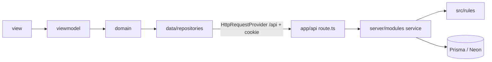

# Arquitectura de CASA

Fuente de verdad de capas, dependencias y el patrón por features (MVVM).

- **Reglas prescriptivas (DEBE / NO DEBE):** `docs/prompts/2_architecture_rules.md`.
- **Decisiones y su porqué:** `docs/decisions/ADR-*.md`.
- **Qué hace la aplicación:** `docs/REQUERIMIENTOS.md`.

## Identidad

- Monolito Next.js 15 (App Router) + React 19 + TypeScript, desplegado en Vercel (ADR-001).
- **UI:** MUI 7 (formularios, botones, layout) y PrimeReact (tablas).
- **Estado del cliente:** Zustand (sesión y usuario) y TanStack Query cuando el feature lo justifique.
- **Sesión:** correo y clave propios, cookie HttpOnly con JWT firmado (ADR-002).
- **Backend:** Route Handlers en `src/app/api` y servicios en `src/server` (ADR-003).
- **Datos:** PostgreSQL en Neon con Prisma (ADR-004).
- **Identidad de marca:** `src/config/appConfig.ts` y `docs/BRANDING.md`. Color primario: verde bosque `#1E5631`.

## Mapa de carpetas

```
prisma/                schema, migraciones y semilla
src/
  middleware.ts        exige sesión en las rutas del panel
  app/                 rutas de pantalla (páginas delgadas) y API
    page.tsx           página pública
    (panel)/           shell (header + menú) y login
    api/               Route Handlers
  features/            frontend por módulo (MVVM)
  rules/               reglas de negocio puras (cuota, recargo, beneficios)
  server/              solo servidor: Prisma, sesión, servicios por módulo
  core/                HTTP del cliente, guards, stores, excepciones, SEO
  providers/           Theme, Query
  shared/              UI kit, layouts, hooks, utils
  styles/              theme MUI y tokens visuales
  config/              identidad del producto (appConfig)
  environments/        ENV del cliente (URL del API, timeouts)
  types/               augmentations (theme MUI, menú)
```

## Flujo de una petición



## Frontend: `features/<nombre>/` (MVVM)

```
src/features/<nombre>/
  data/repositories/   única capa que habla con /api
  domain/              tipos, validación de formularios, orquestación del caso de uso
  viewmodel/           hooks: estado de UI, handlers, navegación, toasts
  view/                componentes de pantalla con el kit compartido
```

Flujo de dependencias: `view → viewmodel → domain → data`.

| Capa | Qué hace | Qué no hace |
|---|---|---|
| `data` | Llama a `/api` con `HttpRequestProvider` y mapea la respuesta a tipos del feature | JSX, estado de UI, reglas de negocio |
| `domain` | Valida entradas del formulario y orquesta el caso de uso. Puede usar `src/rules` para previsualizar valores | JSX, `useState`, HTTP, Prisma |
| `viewmodel` | Estado, handlers, navegación, toasts | JSX de pantalla, HTTP directo |
| `view` | Render y composición de `shared/ui` | Fetch, reglas, hex sueltos |

Referencias vivas:

- **`src/features/login`:** feature completo (correo y clave, sesión).
- **`src/features/form`:** formulario con el kit.
- **`src/features/ejemplo`:** esqueleto para copiar.

## Backend: `app/api` y `server/`

```
src/app/api/<recurso>/route.ts
src/server/
  db/prisma.ts
  auth/          session.ts (cookie y JWT), password.ts (bcrypt), permissions.ts (requirePermission)
  http/          errores uniformes { message, errors? } y helpers de respuesta
  modules/<modulo>/
    <modulo>.schema.ts       Zod
    <modulo>.repository.ts   Prisma, sin reglas
    <modulo>.service.ts      casos de uso, transacciones, bitácora
```

| Capa | Qué hace | Qué no hace |
|---|---|---|
| `route.ts` | Lee la sesión, exige el permiso, valida con Zod y llama al servicio | Reglas de negocio, Prisma directo |
| `service` | Aplica reglas de `src/rules`, abre transacciones y escribe la bitácora | Leer `Request`, armar `Response` |
| `repository` | Consultas Prisma | Reglas, permisos |

Todo archivo de `src/server` importa `server-only`.

## Reglas puras: `src/rules/`

`money.ts`, `calendar.ts`, `fees.ts`, `benefits.ts`.

- Sin React, sin Prisma, sin fetch y sin leer la hora del sistema dentro de la regla: "hoy" entra como parámetro.
- Las usa el servidor para guardar. El `domain` del frontend puede usarlas para mostrar un desglose.
- Cada función tiene prueba en Vitest con los ejemplos de `docs/REQUERIMIENTOS.md`.

## Dependencias permitidas

| Desde | Puede importar |
|---|---|
| `features/*` | `rules`, `shared`, `core`, `styles`, `config`, `environments` |
| `app/(panel)`, `app/page.tsx` | `features`, `core/seo`, `shared` |
| `app/api/*` | `server` |
| `server/*` | `rules` |
| `rules/*` | Nada del proyecto |
| `core`, `shared` | No importan `features`, `server` ni `app` |

## `app/` — rutas

- **Páginas:** son delgadas. Importan la view del feature y exportan `metadata`.
- **Layouts:**
  - `app/(panel)/layout.tsx`: shell con header, menú y migas. `/login` y `/cambiar-clave` son casos especiales sin shell.
  - `app/page.tsx`: página pública, sin shell.
- No contiene lógica de negocio ni llamadas a la API, salvo los `route.ts` de `app/api`.

## `core/` — transversal del cliente

- **`network/httpRequestProvider.ts`:** cliente HTTP (Axios). URL base por defecto `/api`, `withCredentials`, y traducción de errores. Un 401 muestra "Sesión finalizada".
- **`session/sessionPort.ts`:** contrato para revalidar y cerrar la sesión. Lo implementa `features/login`.
- **`guards/AuthGuard.tsx`:** decide con `resolveAuthGate` sobre el store. Es experiencia de usuario, no seguridad.
- **`store/`:** `useUserStore` (usuario sin token: nombre, correo, rol, permisos) y `useSessionStore`.
- **`exceptions/`:** errores de red y HTTP.
- **`seo/`:** metadatos por ruta.

## `shared/` — kit reutilizable

- **`ui/mui/`:** campos y botones canónicos.
- **`ui/primereact/Datatable/`:** tablas (local y API) con exportación a Excel vía `shared/utils/excelExport.ts`.
- **`ui/Modal/`:** diálogos (`AppDialog`, confirmaciones).
- **`layouts/`:** Header, menú lateral y `menuItems.ts`.
- **`hooks/`, `utils/`, `components/`.**

`shared` NO importa `features`. Si un control es de un solo módulo, vive en ese feature.

## `styles/` — apariencia

- `designTokens.ts`: colores de marca y semánticos (fuente de verdad). El primario sale de `brandColor.ts`.
- `theme.ts`: tema MUI que ensambla palette, typography y `customButtons` / `customStyleForm` / layouts.
- Ver `docs/ui-kit.md`.

## Composición de providers (root)

Orden en `src/app/layout.tsx`:

1. `MuiThemeProvider`
2. `QueryProvider`
3. `ToastProvider`
4. `SessionTimeoutProvider`
5. `RouteModalProvider`
6. `SessionBinder` (`features/login`): registra el puerto de sesión y revalida con `/api/auth/me`
7. `AuthGuard`

## Sesión (resumen)

1. Login: `POST /api/auth/login`. El servidor crea la cookie `casa_session` (HttpOnly) y devuelve el usuario. El cliente lo guarda en `useUserStore`, sin token.
2. Al recargar, `SessionBinder` revalida con `GET /api/auth/me`. Si falla, limpia el store.
3. `middleware.ts` redirige a `/login` si falta la cookie en una ruta del panel.
4. Cada `route.ts` exige sesión y permiso. Una petición sin sesión recibe 401 y una sin permiso recibe 403.
5. Inactividad: tras 30 minutos sin actividad se cierra la sesión. Ver `docs/session-timeout-implementation.md`.

## Cómo se agrega un módulo

1. Reglas nuevas en `src/rules` con su prueba.
2. `src/server/modules/<modulo>`: schema, repository, service.
3. `src/app/api/<recurso>/route.ts`.
4. Copiar `src/features/ejemplo` a `src/features/<modulo>` e implementar `data → domain → viewmodel → view`.
5. `src/app/(panel)/<ruta>/page.tsx` delgada.
6. Ítem en `src/shared/layouts/menuItems.ts` con su permiso, y migas si aplica.
7. Documento del módulo en `docs/features/<modulo>.md` (ADR-005).

## Deuda conocida (no copiar)

- **UI:**
  - `uniformFieldHeight3` fuerza radio 0.
  - `GenericTablePagination.tsx` es pieza interna, no base de features.
- **Seguridad del cliente:** el menú y `AuthGuard` no protegen datos. Toda regla de acceso va en la API.
- **Dependencias:** `npm audit` todavía reporta avisos que solo se cierran con saltos mayores (Next 16, next-sitemap 4) y uno moderado de `uuid` dentro de `exceljs` que no aplica (usa `v4`). Se revisan al cambiar de versión mayor.
- **Pruebas:**
  - Unitarias con `npm test`: guard, menú, login, formulario, marca.
  - E2E con `npm run test:e2e`, con la sesión simulada.
